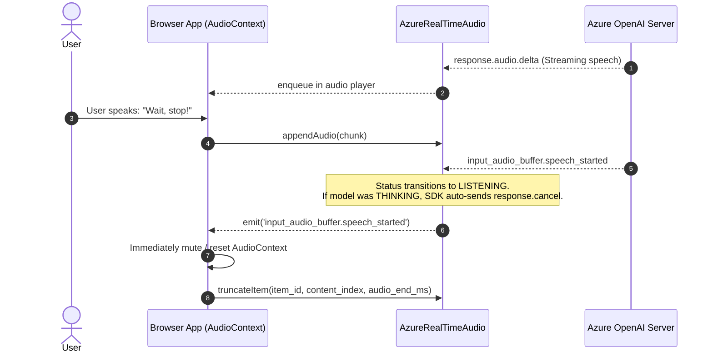
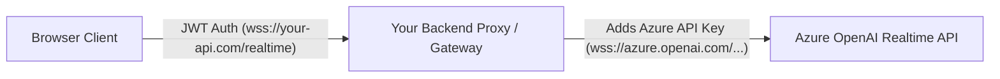

# ⚡ Advanced Topics

This guide explores advanced configurations, production-grade architectures, low-latency optimizations, and resilience strategies for **`azure-realtime-audio-sdk`**.

---

## 1. Barge-In & Interruption Handling Strategy

One of the most natural aspects of real-time voice conversations is the ability for a human to interrupt the AI assistant while it is speaking (called **barge-in**).



### Automatic Interruption in the SDK

- When the Azure server detects incoming speech via Server VAD, it fires `input_audio_buffer.speech_started`.
- If the SDK's internal status is `THINKING`, the SDK **automatically dispatches a `response.cancel` command** to cancel unfinished generation.
- The SDK sets `client.status = ModelStatusEnum.LISTENING`.

### Application Responsibilities During Barge-In

#### 1. Immediately Stop Local Audio Playback

Because browsers buffer and schedule audio in advance via Web Audio API, simply canceling the response on the server will not silence already-buffered audio on the client:

```typescript
client.on("input_audio_buffer.speech_started", () => {
  // 1. Immediately stop scheduled audio playback
  streamingAudioPlayer.stop();
});
```

#### 2. Truncate Conversation Item on Server

If the assistant was interrupted mid-sentence, Azure OpenAI's conversation memory might still assume the assistant finished the entire response. To keep the model's memory accurate:

```typescript
let currentAssistantItemId: string | null = null;
let playbackStartTimestamp: number = 0;

client.on("response.output_item.added", (event) => {
  if (event.item.role === "assistant") {
    currentAssistantItemId = event.item.id;
    playbackStartTimestamp = Date.now();
  }
});

client.on("input_audio_buffer.speech_started", () => {
  if (currentAssistantItemId) {
    const elapsedAudioMs = Math.max(0, Date.now() - playbackStartTimestamp);
    // Tell Azure how much audio the user actually heard
    client.truncateItem(currentAssistantItemId, 0, elapsedAudioMs);
    currentAssistantItemId = null;
  }
});
```

---

## 2. WebSocket Resilience & Reconnection

The SDK uses `easy-websocket-client` internally to manage connection persistence, automatic reconnection, and heartbeat keep-alives.

### Connection Configuration Options

Pass WebSocket options as the second argument to `AzureRealTimeAudio`:

```typescript
import { AzureRealTimeAudio } from "azure-realtime-audio-sdk";

const client = new AzureRealTimeAudio(
  {
    hostName: "your-resource.openai.azure.com",
    apiVersion: "2024-10-01-preview",
    deployment: "gpt-4o-realtime-preview",
    apiKey: process.env.AZURE_OPENAI_API_KEY!,
  },
  {
    // Reconnection settings
    reconnectInterval: 3000, // Wait 3s between reconnect attempts
    maxReconnectAttempts: 10, // Max retries before giving up

    // Heartbeat settings
    heartbeatInterval: 25000, // Send ping every 25 seconds
    timeout: 10000, // Connection timeout in milliseconds
  },
);
```

### Connection State Monitoring

Inspect the underlying connection state using the `state` getter:

```typescript
// WebSocket readyState: 0 (CONNECTING), 1 (OPEN), 2 (CLOSING), 3 (CLOSED)
console.log("Current connection state:", client.state);

if (client.isInitialized) {
  console.log("Session is fully ready for interaction");
}
```

---

## 3. Secure Production Architecture: Backend Proxy Pattern

> [!CAUTION]
> **Never embed Azure OpenAI API keys in frontend client bundles.** Anyone inspecting network traffic or frontend code can extract your key and access your Azure quota.

In production environments, route WebSocket connections through your own backend service or an authenticated reverse proxy:



### Node.js / Express WebSocket Proxy Example

```typescript
import http from "node:http";
import express from "express";
import { WebSocketServer, WebSocket } from "ws";

const app = express();
const server = http.createServer(app);
const wss = new WebSocketServer({ server, path: "/api/realtime-proxy" });

wss.on("connection", (clientWs, req) => {
  // 1. Authenticate user session (e.g. from cookie or Bearer token query param)
  const userToken = new URL(
    req.url!,
    `http://${req.headers.host}`,
  ).searchParams.get("token");
  if (!isValidUser(userToken)) {
    clientWs.close(4001, "Unauthorized");
    return;
  }

  // 2. Connect to Azure OpenAI securely with server-side API Key
  const azureUrl = `wss://${process.env.AZURE_HOST}/openai/realtime?api-version=2024-10-01-preview&deployment=${process.env.AZURE_DEPLOYMENT}&api-key=${process.env.AZURE_API_KEY}`;
  const azureWs = new WebSocket(azureUrl);

  // 3. Bidirectional pipeline
  clientWs.on("message", (data) => {
    if (azureWs.readyState === WebSocket.OPEN) {
      azureWs.send(data);
    }
  });

  azureWs.on("message", (data) => {
    if (clientWs.readyState === WebSocket.OPEN) {
      clientWs.send(data);
    }
  });

  clientWs.on("close", () => azureWs.close());
  azureWs.on("close", () => clientWs.close());
  azureWs.on("error", (err) => console.error("Azure WS error:", err));
});

server.listen(8080);
```

Then in the frontend, initialize the SDK pointing to your proxy endpoint:

```typescript
const client = new AzureRealTimeAudio({
  hostName: "your-api.com/api/realtime-proxy", // Backend proxy
  apiVersion: "",
  deployment: "",
  apiKey: "SESSION_JWT_TOKEN", // User session token instead of Azure API key
});
```

---

## 4. Latency Optimization & AudioWorklet

While `ScriptProcessorNode` is easy to write, it executes on the browser's main thread and can drop audio frames when the UI undergoes heavy rendering.

For optimal low-latency recording in production, implement an **AudioWorklet**:

### `pcm-worklet-processor.js`

```javascript
class PCM16Processor extends AudioWorkletProcessor {
  process(inputs) {
    const input = inputs[0];
    if (input && input[0]) {
      const channelData = input[0];
      const pcm16 = new Int16Array(channelData.length);
      for (let i = 0; i < channelData.length; i++) {
        const s = Math.max(-1, Math.min(1, channelData[i]));
        pcm16[i] = s < 0 ? s * 0x8000 : s * 0x7fff;
      }
      this.port.postMessage(pcm16.buffer, [pcm16.buffer]);
    }
    return true;
  }
}

registerProcessor("pcm16-processor", PCM16Processor);
```

### Main Application

```typescript
const audioContext = new AudioContext({ sampleRate: 24000 });
await audioContext.audioWorklet.addModule("/pcm-worklet-processor.js");

const workletNode = new AudioWorkletNode(audioContext, "pcm16-processor");
workletNode.port.onmessage = (event) => {
  const pcm16Buffer = event.data;
  const base64 = bufferToBase64(pcm16Buffer);
  client.appendAudio(base64);
};

sourceNode.connect(workletNode);
```

---

## 5. Rate Limits & Error Recovery

### Monitoring Rate Limits

Azure OpenAI streams rate limit telemetry in `rate_limits.updated`:

```typescript
client.on("rate_limits.updated", (event) => {
  for (const limit of event.rate_limits) {
    console.log(
      `Resource: ${limit.name}, Remaining: ${limit.remaining}/${limit.limit}, Reset in: ${limit.reset_seconds}s`,
    );
  }
});
```

### Error Event Handling

Listen to the `error` event for runtime diagnostics:

```typescript
client.on("error", (event) => {
  console.error("Realtime API error:", {
    type: event.error.type,
    code: event.error.code,
    message: event.error.message,
    param: event.error.param,
  });

  if (event.error.code === "session_expired") {
    // Re-initialize client or re-create session
  }
});
```
