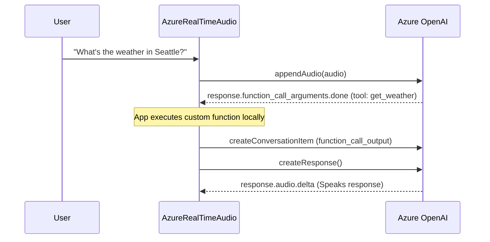

# 💡 Core Guides

This section provides in-depth guides on the core mechanisms of **`azure-realtime-audio-sdk`**, covering audio streaming, turn detection, function calling, state management, and session configuration.

---

## 1. Audio Pipeline & Formats

The Azure OpenAI Realtime API operates as a bidirectional audio stream over WebSocket. Choosing the appropriate audio format, sample rate, and chunk size is critical for achieving low latency and high voice quality.

### Supported Audio Formats

| Format                       | Identifier  | Sample Rate              | Bandwidth / Quality               | Best Used For                              |
| :--------------------------- | :---------- | :----------------------- | :-------------------------------- | :----------------------------------------- |
| **PCM 16-bit** (Recommended) | `pcm16`     | 24,000 Hz (or 16,000 Hz) | High quality, uncompressed        | Modern web applications, native apps       |
| **G.711 μ-law**              | `g711_ulaw` | 8,000 Hz                 | Low bandwidth, telephony standard | Telephony / VoIP in North America & Japan  |
| **G.711 A-law**              | `g711_alaw` | 8,000 Hz                 | Low bandwidth, telephony standard | Telephony / VoIP in Europe & rest of world |

### Recommended Recording Configuration

For modern browser applications, we recommend:

- **Audio Format**: `pcm16`
- **Sample Rate**: `24000` Hz (Native internal rate for OpenAI models)
- **Channels**: `1` (Mono)
- **Bit Depth**: 16-bit signed integer (Little-endian)
- **Chunk Interval**: Send chunks every **100ms to 200ms** (~2048 to 4096 samples at 24kHz). Sending too frequently creates unnecessary WebSocket framing overhead; sending too rarely adds artificial latency to speech detection.

### Browser PCM16 Recording with Web Audio API

```typescript
// Function to capture mono 24kHz PCM16 audio chunks
async function initAudioStream(onChunkReady: (base64Audio: string) => void) {
  const mediaStream = await navigator.mediaDevices.getUserMedia({
    audio: {
      channelCount: 1,
      sampleRate: 24000,
      echoCancellation: true,
      noiseSuppression: true,
      autoGainControl: true,
    },
  });

  const audioCtx = new AudioContext({ sampleRate: 24000 });
  const source = audioCtx.createMediaStreamSource(mediaStream);
  const processor = audioCtx.createScriptProcessor(2048, 1, 1);

  processor.onaudioprocess = (e) => {
    const input = e.inputBuffer.getChannelData(0);
    // Convert float32 array to 16-bit PCM ArrayBuffer
    const pcm16 = new Int16Array(input.length);
    for (let i = 0; i < input.length; i++) {
      const s = Math.max(-1, Math.min(1, input[i]));
      pcm16[i] = s < 0 ? s * 0x8000 : s * 0x7fff;
    }

    // Convert to base64
    let binary = "";
    const bytes = new Uint8Array(pcm16.buffer);
    for (let i = 0; i < bytes.byteLength; i++) {
      binary += String.fromCharCode(bytes[i]);
    }
    onChunkReady(btoa(binary));
  };

  source.connect(processor);
  processor.connect(audioCtx.destination);

  return () => {
    processor.disconnect();
    source.disconnect();
    mediaStream.getTracks().forEach((track) => track.stop());
    audioCtx.close();
  };
}
```

---

## 2. Voice Activity Detection (VAD) & Turn Taking

The SDK supports two turn-taking models:

1. **Server Voice Activity Detection (Server VAD)** — The Azure server detects when the user begins and stops speaking, automatically triggering responses and canceling outdated ones.
2. **Push-to-Talk (Manual Turn Detection)** — The client controls exactly when speech begins and ends.

### Server VAD (Default)

Configured through `turn_detection`:

```typescript
const client = new AzureRealTimeAudio({
  hostName: "your-resource.openai.azure.com",
  apiVersion: "2024-10-01-preview",
  deployment: "gpt-4o-realtime-preview",
  apiKey: process.env.AZURE_OPENAI_API_KEY!,
  sessionConfig: {
    turn_detection: {
      type: "server_vad",
      threshold: 0.4, // Sensitivity (0.0 to 1.0)
      prefix_padding_ms: 300, // Prepend 300ms audio before speech
      silence_duration_ms: 600, // End speech after 600ms silence
    },
  },
});
```

#### How the SDK Handles Interruption (Barge-In)

When Server VAD detects speech while the model is in the `THINKING` state, the SDK **automatically sends a `response.cancel` command** to cancel current generation.

You should listen to `input_audio_buffer.speech_started` to instantly mute or flush your local client audio player:

```typescript
client.on("input_audio_buffer.speech_started", () => {
  console.log("User started speaking! Flushing local audio playback.");
  audioPlayer.stop(); // Stop audio playback immediately
});
```

### Manual Turn-Detection (Push-to-Talk)

To implement a push-to-talk button, disable server VAD by passing `turn_detection: null`:

```typescript
const client = new AzureRealTimeAudio({
  // ...credentials
  sessionConfig: {
    turn_detection: null, // Disable Server VAD
  },
});

// When user holds down the mic button:
function onMicButtonDown() {
  recorder.start();
}

// When user releases the mic button:
function onMicButtonUp() {
  recorder.stop();
  // 1. Commit the buffered audio
  client.commitAudio();
  // 2. Explicitly trigger response generation
  client.createResponse();
}
```

---

## 3. Function Calling & Tool Execution

Tools empower the AI model to query databases, call external APIs, or execute actions in your application.



### Step 1: Declare Tools in `sessionConfig`

```typescript
const client = new AzureRealTimeAudio({
  hostName: "your-resource.openai.azure.com",
  apiVersion: "2024-10-01-preview",
  deployment: "gpt-4o-realtime-preview",
  apiKey: process.env.AZURE_OPENAI_API_KEY!,
  sessionConfig: {
    instructions:
      "You are a smart travel assistant with access to real-time weather data.",
    tools: [
      {
        type: "function",
        name: "get_weather",
        description: "Get current weather conditions for a specified city.",
        parameters: {
          type: "object",
          properties: {
            city: {
              type: "string",
              description: "City name, e.g. Seattle, WA",
            },
            unit: {
              type: "string",
              enum: ["celsius", "fahrenheit"],
              default: "celsius",
            },
          },
          required: ["city"],
        },
      },
    ],
    tool_choice: "auto",
  },
});
```

### Step 2: Handle `response.function_call_arguments.done`

When the model decides to call a function, it emits arguments incrementally, culminating in `response.function_call_arguments.done`:

```typescript
client.on("response.function_call_arguments.done", async (data) => {
  console.log(`Tool invoked: ${data.name}, call_id: ${data.call_id}`);
  const args = JSON.parse(data.arguments);

  let result = {};
  if (data.name === "get_weather") {
    result = await fetchWeather(args.city, args.unit);
  }

  // Send function output back to conversation context
  client.createConversationItem({
    type: "function_call_output",
    call_id: data.call_id,
    output: JSON.stringify(result),
  });

  // Instruct model to formulate audio/text response based on tool result
  client.createResponse();
});
```

---

## 4. State Management & UI Synchronization

The SDK maintains an autonomous state machine accessible via `client.status` and emitted via `status_changed`:

| Status          | Enum Value    | Description                                                         |
| :-------------- | :------------ | :------------------------------------------------------------------ |
| **`IDLE`**      | `'idle'`      | System is waiting for user input or idle.                           |
| **`LISTENING`** | `'listening'` | User is speaking (`input_audio_buffer.speech_started`).             |
| **`THINKING`**  | `'thinking'`  | Model is processing input / generating tokens (`response.created`). |
| **`SPEAKING`**  | `'speaking'`  | Model generated response (`response.done`).                         |

### Binding State to Your UI

```typescript
import { ModelStatusEnum } from "azure-realtime-audio-sdk";

client.on("status_changed", ({ status }) => {
  switch (status) {
    case ModelStatusEnum.IDLE:
      updateUIIcon("idle"); // e.g., gray orb
      break;
    case ModelStatusEnum.LISTENING:
      updateUIIcon("listening"); // e.g., pulsating green mic
      break;
    case ModelStatusEnum.THINKING:
      updateUIIcon("thinking"); // e.g., spinning blue orb
      break;
    case ModelStatusEnum.SPEAKING:
      updateUIIcon("speaking"); // e.g., glowing waveform
      break;
  }
});
```

### Signaling Audio Playback Completion

When the model finishes generating audio on the server, `response.done` triggers and sets `status = 'speaking'`. Because local audio playback takes time to finish streaming through speaker queues, you can call `client.setModelSpeakDone()` once your audio player queue is exhausted to transition cleanly back to `IDLE`:

```typescript
audioPlayer.onQueueEmpty(() => {
  client.setModelSpeakDone(); // Sets client.status to ModelStatusEnum.IDLE
});
```

---

## 5. Conversation Context Management

You can manipulate the conversation history programmatically:

### Adding Custom Messages

You can inject user text, system prompts, or historical messages into the conversation context at any time:

```typescript
// Inject a user text question
client.createConversationItem({
  type: "message",
  role: "user",
  content: [
    {
      type: "input_text",
      text: "Summarize our conversation so far in 3 bullet points.",
    },
  ],
});

// Trigger response generation
client.createResponse();
```

### Deleting and Truncating Items

- **`deleteItem(itemId: string)`**: Removes a message or function call from the server-side context.
- **`truncateItem(itemId: string, contentIndex: number, audioEndMs: number)`**: Truncates an assistant audio item to align server history with what the user actually heard before interrupting.

```typescript
// Truncate assistant response when interrupted at 1500ms
client.truncateItem("item_abc123", 0, 1500);
```

---

## 6. Dynamic Session Updates

You can update session configurations on the fly without reconnecting:

```typescript
// Switch voice to 'shimmer' and update instructions
client.send({
  type: "session.update",
  session: {
    voice: "shimmer",
    instructions: "You are now an Italian culinary chef. Speak with warmth.",
    temperature: 0.8,
  },
});
```

---

## 📚 What's Next?

- Explore practical scenarios in [Use Cases & Examples](/docs/examples).
- Learn about production security and network reconnects in [Advanced Topics](/docs/advanced).
- Review all methods and event payloads in the [API Reference](/docs/api-reference).
