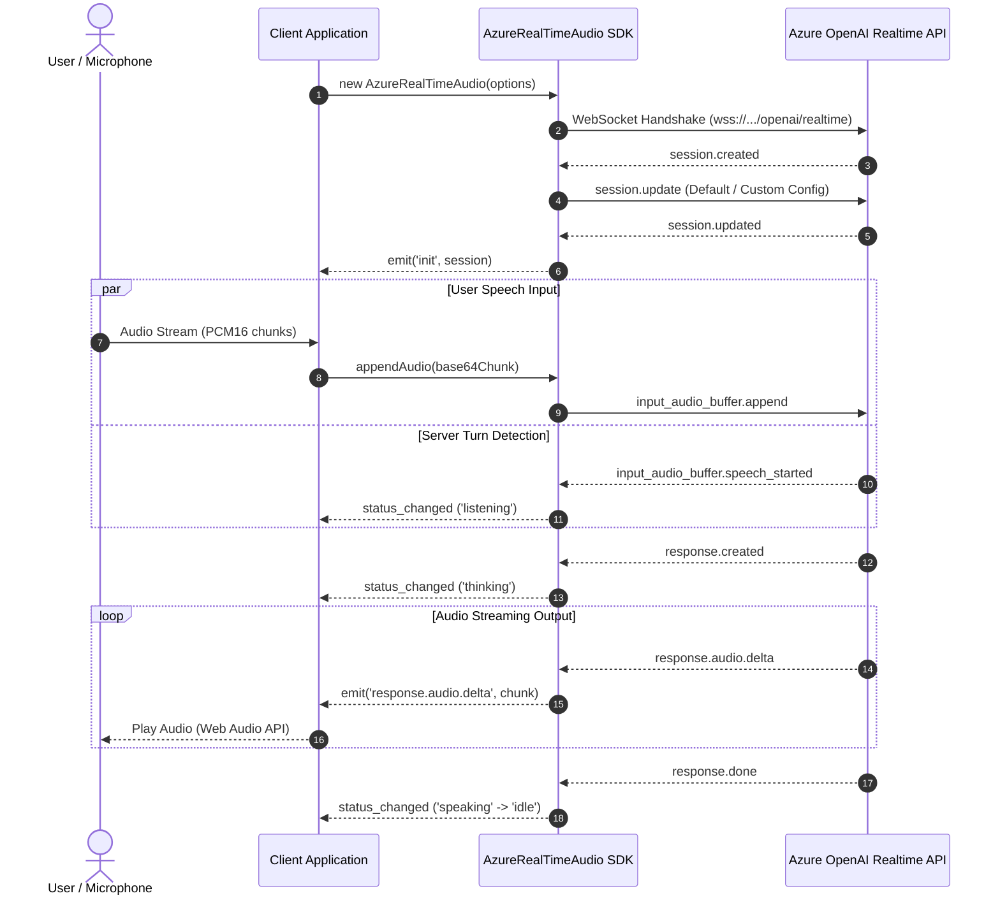

# 🎙️ Azure Realtime Audio SDK

> A lightweight, fully typed TypeScript/JavaScript SDK for building real-time, low-latency voice and multimodal AI applications on top of the **Azure OpenAI Realtime API**.

[](https://www.npmjs.com/package/azure-realtime-audio-sdk)
[](https://opensource.org/licenses/MIT)

---

## 🌟 Why Azure Realtime Audio SDK?

The Azure OpenAI Realtime API enables ultra-low-latency, natural, speech-to-speech conversational experiences powered by models such as `gpt-4o-realtime-preview`. Communicating with this API over raw WebSockets requires managing session lifecycle, audio chunk buffers, message framing, turn detection (VAD), client/server interruptions (barge-in), and state synchronization.

**`azure-realtime-audio-sdk`** abstracts away the transport and protocol complexity:

- 🚀 **Zero Hassle Connection** — Built-in reconnection, heartbeat keep-alive, and authentication management powered by `easy-websocket-client`.
- ⚡ **Full-Duplex Streaming** — Stream PCM16, G.711 μ-law, or G.711 A-law audio bidirectionally with sub-second response times.
- 🎙️ **Smart Turn Detection & Barge-In** — Out-of-the-box support for Server Voice Activity Detection (`server_vad`) with automatic request cancellation when the user interrupts the model.
- 🔄 **Autonomous State Machine** — Tracks AI conversation status in real-time (`idle` ➔ `listening` ➔ `thinking` ➔ `speaking`) with responsive event hooks.
- 🛠️ **Function Calling / Tool Execution** — First-class support for tools, functions, and structured tool-call responses.
- 🎯 **100% Typed** — Complete TypeScript typings generated from the Azure OpenAI Realtime OpenAPI specifications.
- 🌐 **Isomorphic & Universal** — Runs seamlessly in modern browsers and Node.js environments (via custom WebSocket implementations like `ws`).

---

## 🏛️ Architecture Overview

The following diagram illustrates how your application communicates with Azure OpenAI through the SDK:



---

## 📦 Installation

Install the package via your favorite package manager:

```bash npm2yarn
npm install azure-realtime-audio-sdk
```

Or using `pnpm` / `yarn`:

```bash
pnpm add azure-realtime-audio-sdk
# or
yarn add azure-realtime-audio-sdk
```

---

## ⚡ Quick Start

Here is a minimal example demonstrating how to initialize the client, connect to Azure OpenAI, and listen for streamed audio:

```typescript
import { AzureRealTimeAudio } from "azure-realtime-audio-sdk";

// Initialize the client
const client = new AzureRealTimeAudio({
  hostName: "your-resource.openai.azure.com",
  apiVersion: "2024-10-01-preview",
  deployment: "gpt-4o-realtime-preview",
  apiKey: process.env.AZURE_OPENAI_API_KEY!,
  sessionConfig: {
    voice: "alloy",
    instructions: "You are a helpful, cheerful voice assistant.",
  },
});

// 1. Session initialization completed
client.once("init", (event) => {
  console.log("Session ready:", event.session.id);
});

// 2. Stream audio response chunks from the model
client.on("response.audio.delta", (event) => {
  console.log(`Received ${event.delta.length} base64 audio characters`);
  // Decode and feed to your audio playback engine
});

// 3. Receive real-time speech transcription
client.on("response.audio_transcript.delta", (event) => {
  process.stdout.write(event.delta);
});

// 4. Handle state transitions
client.on("status_changed", ({ status }) => {
  console.log("Current Model Status:", status); // 'idle' | 'listening' | 'thinking' | 'speaking'
});

// 5. Catch connection or runtime errors
client.on("error", (err) => {
  console.error("Realtime error:", err);
});
```

---

## 🗺️ Documentation Sitemap

Explore detailed guides and references across our documentation:

| Guide                                   | Description                                                                     |
| :-------------------------------------- | :------------------------------------------------------------------------------ |
| [🚀 Quick Start](/docs/getting-started) | Step-by-step setup, browser audio recording, and playback pipeline              |
| [📖 API Reference](/docs/api-reference) | Complete documentation of all methods, events, options, and enums               |
| [💡 Core Guides](/docs/guides)          | Audio pipeline, Turn Detection (VAD), Tool calling, and state management        |
| [💻 Practical Examples](/docs/examples) | Real-world applications: Voice Assistant, Push-to-Talk, and Customer Support    |
| [⚡ Advanced Topics](/docs/advanced)    | Interruption (barge-in), WebSocket resilience, security proxy, and optimization |
| [🛠️ Development](/docs/development)     | Monorepo structure, local build commands, testing, and debugging                |
| [🤝 Contributing](/docs/contributing)   | Contribution guidelines, conventional commits, and pull requests                |

---

## 💬 Community and Support

- **Issues & Feature Requests**: [GitHub Issues](https://github.com/JsonLee12138/azure-realtime-audio-sdk/issues)
- **Discord Community**: [Join Discord](https://discord.gg/666U6JTCQY)
- **QQ Channel**: [Join QQ Group](https://pd.qq.com/s/fjwy3eo20?b=9)

---

## 📄 License

Licensed under the [MIT License](https://github.com/JsonLee12138/azure-realtime-audio-sdk/blob/main/LICENSE).
