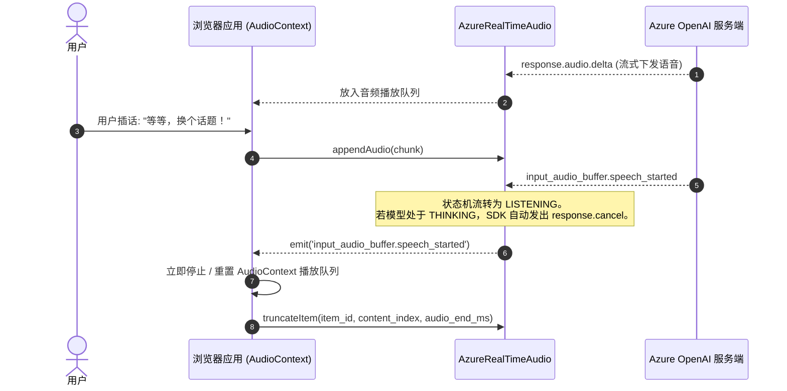
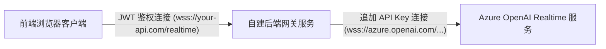

# ⚡ 进阶专题

本篇涵盖 **`azure-realtime-audio-sdk`** 的高级配置、生产架构、延迟极致优化及高可用容灾策略。

---

## 1. 语音打断 (Barge-In) 机制深度解析

在实时语音交互中，用户随时可能打断 AI 助手的回答。妥善处理打断是实现自然人机交流的核心。



### SDK 内部的自动打断逻辑

- 当服务端 VAD 检测到用户开始说话时，下发 `input_audio_buffer.speech_started`。
- 如果 SDK 当前处于思考状态（`status === ModelStatusEnum.THINKING`），SDK **会自动调用 `response.cancel` 向服务端终止回答生成**。
- SDK 将自身状态更新为 `ModelStatusEnum.LISTENING`。

### 应用层在打断时的配合

#### 1. 立即清空本地扬声器播放队列

由于 Web Audio API 在浏览器底层通常有缓冲调度机制，仅服务端取消不会立刻停止用户耳朵听到的已入队声音：

```typescript
client.on("input_audio_buffer.speech_started", () => {
  // 立即清空并重置本地音频播放器
  streamingAudioPlayer.stop();
});
```

#### 2. 服务端对话项截断 (`truncateItem`)

如果助手被中途打断，OpenAI 服务端的会话历史仍然可能记录了完整的回答。为了让大模型的上下文记忆与用户实际听到的内容一致，应调用 `truncateItem`：

```typescript
let currentAssistantItemId: string | null = null;
let playbackStartTimestamp: number = 0;

client.on("response.output_item.added", (event) => {
  if (event.item.role === "assistant") {
    currentAssistantItemId = event.item.id;
    playbackStartTimestamp = Date.now();
  }
});

client.on("input_audio_buffer.speech_started", () => {
  if (currentAssistantItemId) {
    const elapsedAudioMs = Math.max(0, Date.now() - playbackStartTimestamp);
    // 告知服务端用户实际听到的音频毫秒数
    client.truncateItem(currentAssistantItemId, 0, elapsedAudioMs);
    currentAssistantItemId = null;
  }
});
```

---

## 2. WebSocket 连接韧性与心跳重连

SDK 内部集成 `easy-websocket-client`，支持心跳探测与网络断线自动重连。

### 自定义 WebSocket 参数

```typescript
import { AzureRealTimeAudio } from "azure-realtime-audio-sdk";

const client = new AzureRealTimeAudio(
  {
    hostName: "your-resource.openai.azure.com",
    apiVersion: "2024-10-01-preview",
    deployment: "gpt-4o-realtime-preview",
    apiKey: process.env.AZURE_OPENAI_API_KEY!,
  },
  {
    reconnectInterval: 3000, // 断线后重连尝试间隔 (3秒)
    maxReconnectAttempts: 10, // 最大重试次数
    heartbeatInterval: 25000, // 每隔 25 秒发送一次心跳保活
    timeout: 10000, // 连接超时阈值
  },
);
```

### 连接状态监测

```typescript
// readyState 状态值: 0 (CONNECTING), 1 (OPEN), 2 (CLOSING), 3 (CLOSED)
console.log("当前底层连接状态:", client.state);

if (client.isInitialized) {
  console.log("会话已完成协商，可以随时收发音频");
}
```

---

## 3. 生产安全架构：后端代理转发模式

> [!CAUTION]
> **绝对不要在前端客户端代码中硬编码或打包 Azure OpenAI API Key。** 任何访问网页的用户都可以通过浏览器控制台轻易提取该密钥并耗尽您的配额。

在生产环境中，应将 WebSocket 连接路由至您自己的后端代理服务：



### Node.js / Express 代理服务范例

```typescript
import http from "node:http";
import express from "express";
import { WebSocketServer, WebSocket } from "ws";

const app = express();
const server = http.createServer(app);
const wss = new WebSocketServer({ server, path: "/api/realtime-proxy" });

wss.on("connection", (clientWs, req) => {
  // 1. 校验用户登录凭证 (如 Cookie 或 URL 参数中的 JWT Token)
  const token = new URL(
    req.url!,
    `http://${req.headers.host}`,
  ).searchParams.get("token");
  if (!verifyUserToken(token)) {
    clientWs.close(4001, "Unauthorized");
    return;
  }

  // 2. 服务端安全追加 Azure API 密钥并发起连接
  const azureUrl = `wss://${process.env.AZURE_HOST}/openai/realtime?api-version=2024-10-01-preview&deployment=${process.env.AZURE_DEPLOYMENT}&api-key=${process.env.AZURE_API_KEY}`;
  const azureWs = new WebSocket(azureUrl);

  // 3. 双向数据透明透传
  clientWs.on("message", (msg) => {
    if (azureWs.readyState === WebSocket.OPEN) azureWs.send(msg);
  });
  azureWs.on("message", (msg) => {
    if (clientWs.readyState === WebSocket.OPEN) clientWs.send(msg);
  });

  clientWs.on("close", () => azureWs.close());
  azureWs.on("close", () => clientWs.close());
  azureWs.on("error", (err) => console.error("Azure WS 异常:", err));
});

server.listen(8080);
```

前端只需将连接目标指向自建网关：

```typescript
const client = new AzureRealTimeAudio({
  hostName: "your-api.com/api/realtime-proxy",
  apiVersion: "",
  deployment: "",
  apiKey: "USER_JWT_TOKEN", // 传入业务 Session Token 替代云厂商密钥
});
```

---

## 4. 极致低延迟优化：AudioWorklet 录音方案

虽然 `ScriptProcessorNode` 编写直观，但它运行在浏览器主渲染线程中，遇到页面复杂重绘或 DOM 运算时容易发生音频卡顿或掉帧。

生产环境建议使用 **AudioWorklet** 在独立音频线程中进行 PCM16 格式转换：

### `pcm-worklet-processor.js`

```javascript
class PCM16Processor extends AudioWorkletProcessor {
  process(inputs) {
    const input = inputs[0];
    if (input && input[0]) {
      const channelData = input[0];
      const pcm16 = new Int16Array(channelData.length);
      for (let i = 0; i < channelData.length; i++) {
        const s = Math.max(-1, Math.min(1, channelData[i]));
        pcm16[i] = s < 0 ? s * 0x8000 : s * 0x7fff;
      }
      this.port.postMessage(pcm16.buffer, [pcm16.buffer]);
    }
    return true;
  }
}

registerProcessor("pcm16-processor", PCM16Processor);
```

### 主应用加载 Worklet

```typescript
const audioContext = new AudioContext({ sampleRate: 24000 });
await audioContext.audioWorklet.addModule("/pcm-worklet-processor.js");

const workletNode = new AudioWorkletNode(audioContext, "pcm16-processor");
workletNode.port.onmessage = (event) => {
  const pcm16Buffer = event.data;
  client.appendAudio(bufferToBase64(pcm16Buffer));
};

sourceNode.connect(workletNode);
```

---

## 5. 限流监控与错误恢复

### 监控 Token 与请求速率限制

Azure OpenAI 会通过 `rate_limits.updated` 事件下发当前的配额消耗信息：

```typescript
client.on("rate_limits.updated", (event) => {
  for (const limit of event.rate_limits) {
    console.log(
      `配额项: ${limit.name}, 剩余可用: ${limit.remaining}/${limit.limit}, 重置剩余秒数: ${limit.reset_seconds}`,
    );
  }
});
```

### 错误捕获与自愈

```typescript
client.on("error", (event) => {
  console.error("Realtime API 报错:", {
    type: event.error.type,
    code: event.error.code,
    message: event.error.message,
  });

  if (event.error.code === "session_expired") {
    // 处理会话过期，重新初始化客户端
  }
});
```
