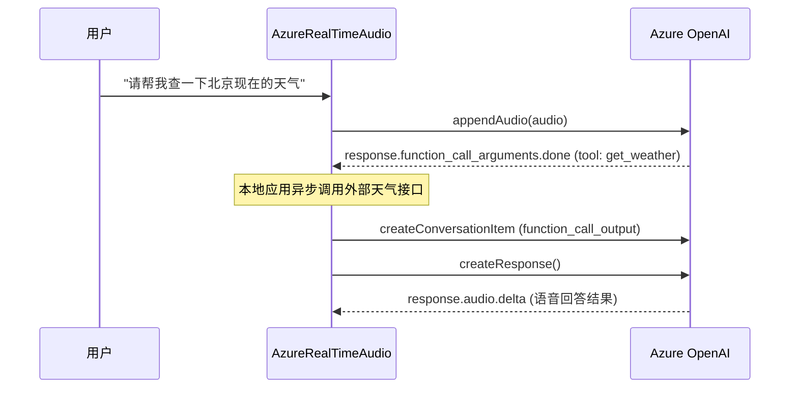

# 💡 核心指南

本章节深入介绍 **`azure-realtime-audio-sdk`** 的核心工作机制，涵盖音频流管线、打断与轮次检测、函数调用（Tool Calling）、状态机以及动态会话更新。

---

## 1. 音频流管线与格式说明

Azure OpenAI Realtime API 基于 WebSocket 进行双向流式音频传输。选择合适的音频格式、采样率与分片间隔，对于保证低延迟和高语音清晰度至关重要。

### 支持的音频格式

| 音频格式              | 标识符      | 推荐采样率             | 带宽 / 音质        | 典型适用场景                         |
| :-------------------- | :---------- | :--------------------- | :----------------- | :----------------------------------- |
| **PCM 16-bit** (推荐) | `pcm16`     | 24,000 Hz 或 16,000 Hz | 高保真无压缩       | 现代 Web 应用、客户端、桌面端应用    |
| **G.711 μ-law**       | `g711_ulaw` | 8,000 Hz               | 极低带宽、电信标准 | 北美与日本传统电信/VoIP 系统对接     |
| **G.711 A-law**       | `g711_alaw` | 8,000 Hz               | 极低带宽、电信标准 | 欧洲与全球其它地区电信/VoIP 系统对接 |

### 推荐的录音参数

对于现代 Web 应用，我们强烈推荐：

- **音频格式**: `pcm16`
- **采样率**: `24000` Hz（OpenAI Realtime 模型内部原生采样率）
- **通道数**: 单声道 (`channelCount: 1`)
- **采样位数**: 16 位有符号整型（小端序 Little-Endian）
- **分片发送间隔**: 每 **100ms ~ 200ms** 发送一次分片（24kHz 下约 2048 到 4096 采样点）。分片过密会增加 WebSocket 帧头开销；分片过大则会引入额外的人工延迟。

### 浏览器 Web Audio API 采集 PCM16 代码

```typescript
async function initAudioStream(onChunkReady: (base64Audio: string) => void) {
  const mediaStream = await navigator.mediaDevices.getUserMedia({
    audio: {
      channelCount: 1,
      sampleRate: 24000,
      echoCancellation: true,
      noiseSuppression: true,
      autoGainControl: true,
    },
  });

  const audioCtx = new AudioContext({ sampleRate: 24000 });
  const source = audioCtx.createMediaStreamSource(mediaStream);
  const processor = audioCtx.createScriptProcessor(2048, 1, 1);

  processor.onaudioprocess = (e) => {
    const input = e.inputBuffer.getChannelData(0);
    const pcm16 = new Int16Array(input.length);
    for (let i = 0; i < input.length; i++) {
      const s = Math.max(-1, Math.min(1, input[i]));
      pcm16[i] = s < 0 ? s * 0x8000 : s * 0x7fff;
    }

    let binary = "";
    const bytes = new Uint8Array(pcm16.buffer);
    for (let i = 0; i < bytes.byteLength; i++) {
      binary += String.fromCharCode(bytes[i]);
    }
    onChunkReady(btoa(binary));
  };

  source.connect(processor);
  processor.connect(audioCtx.destination);

  return () => {
    processor.disconnect();
    source.disconnect();
    mediaStream.getTracks().forEach((track) => track.stop());
    audioCtx.close();
  };
}
```

---

## 2. 语音活动检测 (VAD) 与轮次管理

SDK 支持两种轮次接管模式：

1. **服务端语音活动检测 (Server VAD)** — 服务端实时识别人声起止，自动触发回复并打断正在进行的生成。
2. **对讲机模式 (Push-to-Talk)** — 完全由客户端控制说话的起止时机。

### 服务端 VAD (默认模式)

通过 `turn_detection` 参数进行配置：

```typescript
const client = new AzureRealTimeAudio({
  hostName: "your-resource.openai.azure.com",
  apiVersion: "2024-10-01-preview",
  deployment: "gpt-4o-realtime-preview",
  apiKey: process.env.AZURE_OPENAI_API_KEY!,
  sessionConfig: {
    turn_detection: {
      type: "server_vad",
      threshold: 0.4, // 检测灵敏度 (0.0 到 1.0)
      prefix_padding_ms: 300, // 语音开始前预填充毫秒数
      silence_duration_ms: 600, // 判定说话结束所需的静音毫秒数
    },
  },
});
```

#### SDK 如何处理用户插话打断 (Barge-In)

当 Server VAD 检测到用户开始说话且模型正在思考 (`THINKING`) 时，SDK **会自动向服务端发送 `response.cancel` 命令**。

应用层建议监听 `input_audio_buffer.speech_started` 事件，立刻停止本地扬声器中的未播完音频：

```typescript
client.on("input_audio_buffer.speech_started", () => {
  console.log("检测到用户开始说话，立即停止本地播放队列");
  audioPlayer.stop();
});
```

### 手动轮次控制 (Push-to-Talk)

设置 `turn_detection: null` 即可禁用服务端自动 VAD：

```typescript
const client = new AzureRealTimeAudio({
  // ...凭证参数
  sessionConfig: {
    turn_detection: null, // 禁用自动 VAD
  },
});

// 按下麦克风按键时：
function onMicButtonDown() {
  recorder.start();
}

// 松开麦克风按键时：
function onMicButtonUp() {
  recorder.stop();
  // 1. 提交录音缓冲区
  client.commitAudio();
  // 2. 主动触发模型回复
  client.createResponse();
}
```

---

## 3. 函数调用 (Function Calling)

通过 Tool Calling，模型能够查询数据库、调用三方 API 或控制业务逻辑。



### 第一步：在 `sessionConfig` 中声明工具列表

```typescript
const client = new AzureRealTimeAudio({
  hostName: "your-resource.openai.azure.com",
  apiVersion: "2024-10-01-preview",
  deployment: "gpt-4o-realtime-preview",
  apiKey: process.env.AZURE_OPENAI_API_KEY!,
  sessionConfig: {
    instructions: "你是一个智能差旅助理，能够实时查询天气并回答用户。",
    tools: [
      {
        type: "function",
        name: "get_weather",
        description: "根据城市名称查询当前的实时天气数据。",
        parameters: {
          type: "object",
          properties: {
            city: { type: "string", description: "城市名，例如 北京、上海" },
            unit: {
              type: "string",
              enum: ["celsius", "fahrenheit"],
              default: "celsius",
            },
          },
          required: ["city"],
        },
      },
    ],
    tool_choice: "auto",
  },
});
```

### 第二步：监听 `response.function_call_arguments.done`

```typescript
client.on("response.function_call_arguments.done", async (data) => {
  console.log(`模型发起函数调用: ${data.name}, call_id: ${data.call_id}`);
  const args = JSON.parse(data.arguments);

  let result = {};
  if (data.name === "get_weather") {
    result = await fetchWeather(args.city, args.unit);
  }

  // 将函数执行结果返回给对话上下文
  client.createConversationItem({
    type: "function_call_output",
    call_id: data.call_id,
    output: JSON.stringify(result),
  });

  // 通知模型根据返回结果组织语言并生成语音回答
  client.createResponse();
});
```

---

## 4. 状态管理与 UI 联动

SDK 维护了一套自主运行的状态机，可通过 `client.status` 访问，并会触发 `status_changed` 事件：

| 状态            | 枚举值        | 含义                                                 |
| :-------------- | :------------ | :--------------------------------------------------- |
| **`IDLE`**      | `'idle'`      | 系统空闲，等待用户说话。                             |
| **`LISTENING`** | `'listening'` | 用户正在说话 (`input_audio_buffer.speech_started`)。 |
| **`THINKING`**  | `'thinking'`  | 模型正在思考与生成输出 (`response.created`)。        |
| **`SPEAKING`**  | `'speaking'`  | 模型已生成回答 (`response.done`)。                   |

### 界面状态绑定

```typescript
import { ModelStatusEnum } from "azure-realtime-audio-sdk";

client.on("status_changed", ({ status }) => {
  switch (status) {
    case ModelStatusEnum.IDLE:
      updateAvatar("idle"); // 灰色静止状态
      break;
    case ModelStatusEnum.LISTENING:
      updateAvatar("listening"); // 绿色麦克风呼吸动画
      break;
    case ModelStatusEnum.THINKING:
      updateAvatar("thinking"); // 旋转思考光圈
      break;
    case ModelStatusEnum.SPEAKING:
      updateAvatar("speaking"); // 动态语音波形动效
      break;
  }
});
```

### 标记本地音频播放完毕

当服务端输出完所有的音频切片后会触发 `response.done` 并将状态置为 `speaking`。但本地浏览器需要一定时间将队列中的音频播放完毕。您可以在本地音频队列播放完成后调用 `client.setModelSpeakDone()`，使状态重置回 `IDLE`：

```typescript
audioPlayer.onQueueFinished(() => {
  client.setModelSpeakDone(); // 将 client.status 重置为 ModelStatusEnum.IDLE
});
```

---

## 5. 对话上下文管理

### 动态插入消息

您可以在对话进行中随时注入文本指令或上下文：

```typescript
// 主动向对话中插入一条用户文字问题
client.createConversationItem({
  type: "message",
  role: "user",
  content: [
    {
      type: "input_text",
      text: "请用三句话总结我们刚刚的讨论。",
    },
  ],
});

client.createResponse();
```

### 截断与删除对话项

- **`deleteItem(itemId: string)`**: 从服务端记忆中移除某条消息或函数调用。
- **`truncateItem(itemId: string, contentIndex: number, audioEndMs: number)`**: 当用户打断模型说话时，用于截断助手音频项，使服务端记忆与用户实际听到的内容保持一致。

---

## 6. 动态更新会话参数

支持在不断开 WebSocket 连接的前提下动态更改系统指令、音色或温度：

```typescript
client.send({
  type: "session.update",
  session: {
    voice: "shimmer",
    instructions: "你现在是一位资深的心理咨询师，语气温和有耐心。",
    temperature: 0.7,
  },
});
```
