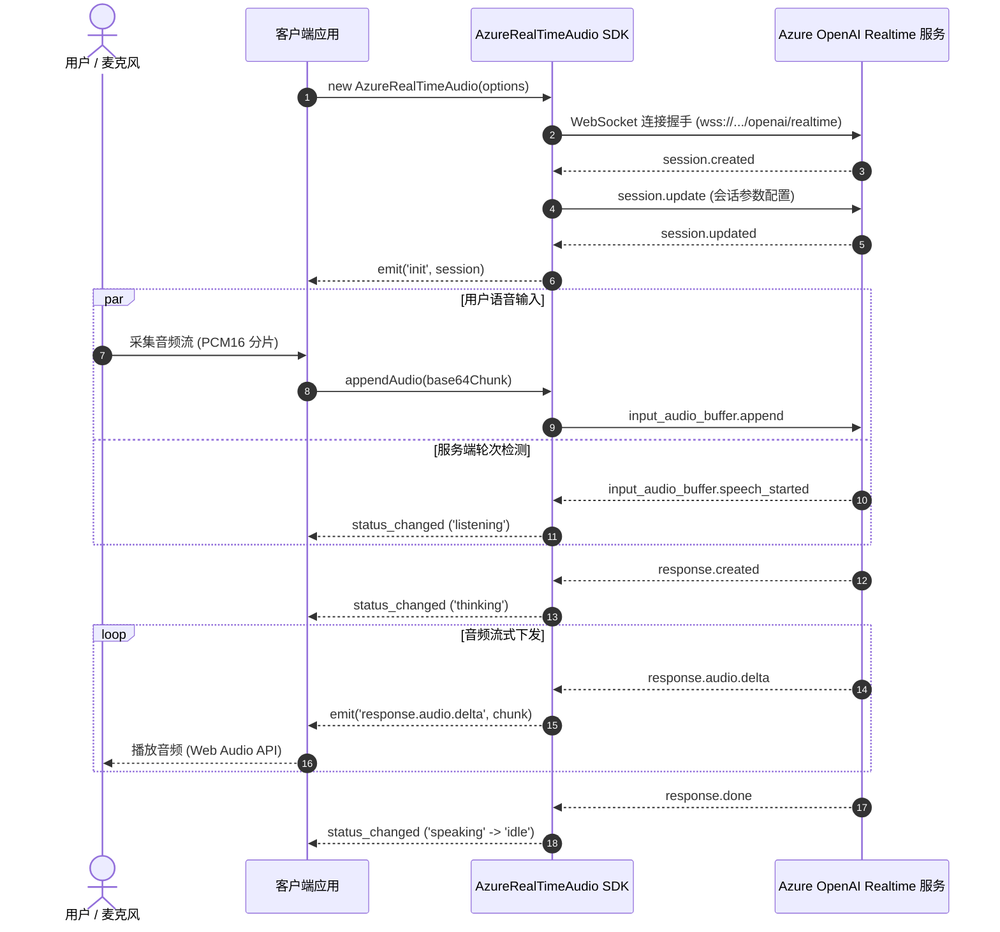

# 🎙️ Azure Realtime Audio SDK

> 轻量级、全类型的 TypeScript/JavaScript SDK，专为构建基于 **Azure OpenAI Realtime API** 的低延迟实时语音与多模态 AI 交互应用而设计。

[](https://www.npmjs.com/package/azure-realtime-audio-sdk)
[](https://opensource.org/licenses/MIT)

---

## 🌟 核心特性

- 🎤 **超低延迟实时语音交互** — 支持全双工双向流式音频输入与输出，毫秒级响应。
- 🔊 **多音频格式支持** — 原生支持 PCM16 (24kHz/16kHz)、G.711 μ-law 及 G.711 A-law 格式。
- 🌐 **高可靠 WebSocket 通信** — 基于 `easy-websocket-client`，内置自动重连、心跳保活与连接状态监控。
- 🎙️ **智能轮次检测与打断 (Barge-in)** — 开箱即用的服务端语音活动检测 (`server_vad`)，并在用户插话时自动发送取消请求并管理状态机。
- 🛠️ **工具与函数调用 (Function Calling)** — 完备的 Tool Calling 流程封装，轻松扩展企业数据或业务接口。
- 📝 **语音转文字 (STT)** — 内置 Whisper-1 模型实时转写用户输入与 AI 输出文本增量。
- 🎯 **TypeScript 原生支持** — 基于 Azure OpenAI Realtime 官方 OpenAPI 3.0 规范生成的全类型定义与 IDE 智能提示。
- 🔄 **自主状态机** — 实时维护模型状态（`idle` 空闲、`listening` 聆听、`thinking` 思考、`speaking` 回答）并触发事件。
- 🌍 **全环境同构** — 无缝兼容现代浏览器环境与 Node.js 服务端（支持传入自定义 WebSocket 如 `ws`）。

---

## 🏛️ 系统架构



---

## 📦 安装

使用您喜欢的包管理器安装：

```bash
npm install azure-realtime-audio-sdk
# 或
pnpm add azure-realtime-audio-sdk
# 或
yarn add azure-realtime-audio-sdk
```

---

## ⚡ 快速体验

```typescript
import { AzureRealTimeAudio } from "azure-realtime-audio-sdk";

// 1. 初始化客户端实例
const client = new AzureRealTimeAudio({
  hostName: "your-resource.openai.azure.com",
  apiVersion: "2024-10-01-preview",
  deployment: "gpt-4o-realtime-preview",
  apiKey: process.env.AZURE_OPENAI_API_KEY!,
  sessionConfig: {
    voice: "alloy",
    instructions: "你是一个热情专业的实时语音助手，请简练回答问题。",
  },
});

// 2. 监听会话就绪
client.once("init", (data) => {
  console.log("会话初始化完成:", data.session.id);
});

// 3. 接收模型回答音频流
client.on("response.audio.delta", (data) => {
  console.log(`收到 ${data.delta.length} 字符的 base64 音频切片`);
});

// 4. 监听实时文本转写
client.on("response.audio_transcript.delta", (data) => {
  process.stdout.write(data.delta);
});

// 5. 监听状态变化
client.on("status_changed", ({ status }) => {
  console.log("当前模型状态:", status);
});

// 6. 监听错误异常
client.on("error", (err) => {
  console.error("Realtime 连接或运行时错误:", err);
});
```

---

## 📖 文档导航

| 文档章节                             | 描述                                                |
| :----------------------------------- | :-------------------------------------------------- |
| [🚀 快速开始](/docs/getting-started) | 逐步上手、浏览器音频采集与播放管线全解析            |
| [📖 API 参考](/docs/api-reference)   | 类、方法、事件枚举与类型定义全景参考                |
| [💡 核心指南](/docs/guides)          | 音频流、打断检测 (VAD)、函数调用及状态机深度解析    |
| [💻 实战示例](/docs/examples)        | 语音助手、对讲机 Push-to-Talk 与客服 Agent 范例     |
| [⚡ 进阶专题](/docs/advanced)        | 打断策略 (Barge-in)、网络重连、安全代理与延迟优化   |
| [🛠️ 本地开发](/docs/development)     | Monorepo 架构、Rolldown 打包、Vitest 测试与代码生成 |
| [🤝 贡献指南](/docs/contributing)    | 社区贡献规范、Conventional Commits 与 Pull Request  |

---

## 💬 社区与技术支持

- **问题反馈与建议**: [GitHub Issues](https://github.com/JsonLee12138/azure-realtime-audio-sdk/issues)
- **Twitter (X)**: [@json_lee12138](https://x.com/json_lee12138)
- **Discord 交流群**: [加入 Discord](https://discord.gg/666U6JTCQY)
- **QQ 频道/交流群**: [加入 QQ 群](https://pd.qq.com/s/fjwy3eo20?b=9)

---

## 📄 开源许可

本项目遵循 [MIT License](https://github.com/JsonLee12138/azure-realtime-audio-sdk/blob/main/LICENSE) 开源协议。
